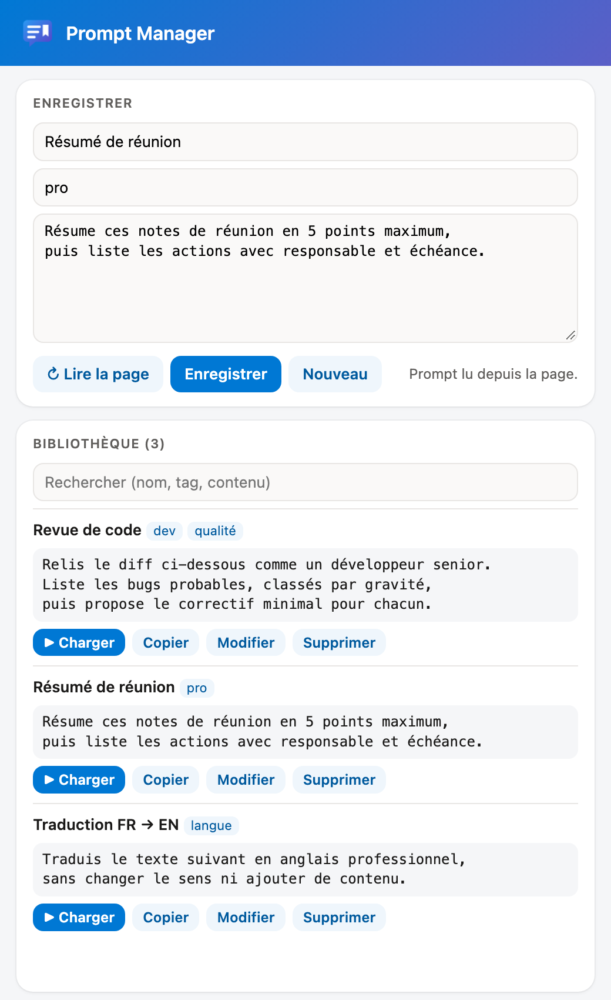
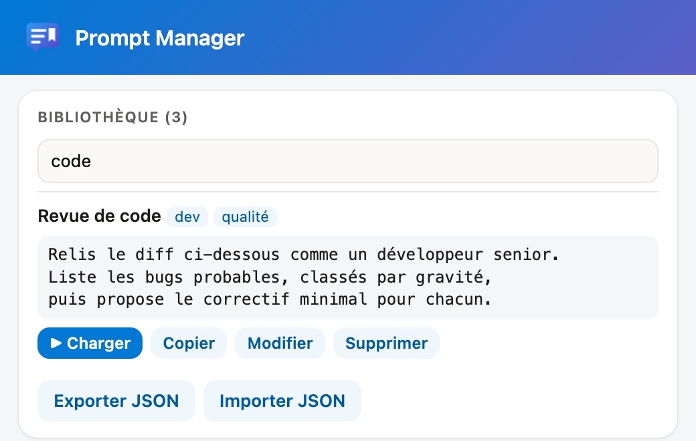
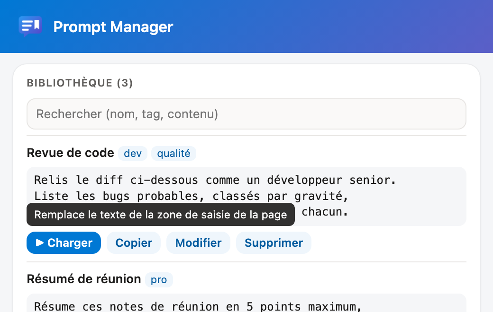
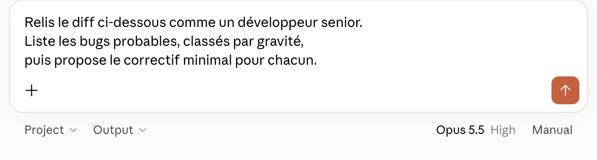

# Prompt Manager

*Bibliothèque de prompts pour les sites d'IA.* · [English version](README.en.md)

Extension Chrome / Edge (Manifest V3) : bibliothèque locale de prompts, avec tags et recherche, utilisable sur les sites d'IA (Claude, ChatGPT, DeepSeek, Perplexity…). Enregistrer le prompt écrit dans la zone de saisie de la page, le retrouver, le recharger en un clic.⁣‌‌‌‌‌‌‌​​​‌​​​‌​​‍‌⁣



## Sites pris en charge

L'extension agit sur l'onglet actif, quel que soit le site : elle cherche la zone de saisie de la page (celle qui a le focus, sinon la zone de texte visible la plus basse).

| Site | Éditeur | Vérifié |
|---|---|---|
| Claude (`claude.ai`) | ProseMirror | Lecture et écriture, sauts de ligne compris |
| ChatGPT (`chatgpt.com`) | ProseMirror | Lecture et écriture, sauts de ligne compris |
| DeepSeek (`chat.deepseek.com`) | `textarea` | Lecture et écriture, sauts de ligne compris |
| Perplexity (`perplexity.ai`) | Lexical | Lecture et écriture, sauts de ligne compris |
| Autres sites (Gemini, Mistral, Kilo, Copilot…) | `textarea` ou `contenteditable` | Même mécanisme, non vérifié site par site |

Si aucune zone de saisie n'est trouvée, « Charger » copie le prompt dans le presse-papiers.

## Installation

1. Ouvrir `chrome://extensions` (ou `edge://extensions`) et activer le **mode développeur**.
2. **Charger l'extension non empaquetée** et choisir ce dossier.
3. Épingler l'icône (bulle bleue) dans la barre d'outils.

Après une mise à jour du code : bouton ↻ de l'extension dans `chrome://extensions`.

## Utilisation

### Enregistrer un prompt

1. Écrire le prompt dans la zone de saisie du site d'IA (sans l'envoyer).
2. Ouvrir le menu de l'extension : le prompt est lu automatiquement. « ↻ Lire la page » le relit.
3. Saisir un nom et, si besoin, des tags séparés par des virgules.
4. **Enregistrer**. Le formulaire se vide : l'enregistrement suivant crée une nouvelle entrée.

Le prompt peut aussi être collé à la main dans le champ.

### Retrouver un prompt

Tous les mots de la recherche doivent apparaître dans le nom, les tags ou le texte du prompt (casse ignorée).



### Charger un prompt

**▶ Charger** remplace le texte de la zone de saisie de la page par le prompt, sans l'envoyer. Le survol du bouton le rappelle :



Résultat dans Claude :



### Autres actions

- **Copier** : copie le prompt dans le presse-papiers.
- **Modifier** (ou clic sur le nom) : remplit le formulaire ; « Enregistrer » met à jour l'entrée. « Nouveau » annule.
- **Supprimer** : deux clics (« Confirmer ? »).
- **Exporter JSON** : télécharge toute la bibliothèque (`prompts-AAAA-MM-JJ.json`).
- **Importer JSON** : ouvre le menu dans un onglet (le sélecteur de fichier ferme le menu), puis choisir le fichier. Les entrées invalides sont ignorées ; une entrée de même `id` est remplacée.

## Données

Stockage local au profil du navigateur : `chrome.storage.local`, clé `prompts`, entrées les plus récentes en premier.

```json
[{ "id": "uuid", "name": "Revue de code", "tags": ["dev"], "prompt": "Relis le diff ci-dessous…", "updated": "2026-10-04T12:00:00.000Z" }]
```

Rien n'est envoyé ailleurs. Exporter régulièrement pour sauvegarder ou partager la bibliothèque.

## Architecture

Même principes que MDE Kusto Saver : pas d'étape de build, JavaScript vanilla, fonctions pures dans `lib.js` testées sous Node.

| Fichier | Rôle |
|---|---|
| `manifest.json` | Permissions `activeTab`, `scripting`, `storage`, `unlimitedStorage` ; aucune permission d'hôte permanente |
| `popup.html` / `popup.js` | Menu (aussi page d'options ouverte en onglet) : formulaire, liste, import / export, fonction `composer` injectée dans la page |
| `lib.js` | `isWebPage`, `parseTags`, `matches`, `upsert`, `mergeImport` |
| `test.js` | Tests : `node test.js` (Node 18+) |
| `icons/` | `icon.svg` (source : bulle de discussion + signet) et rendus PNG 16 / 32 / 48 / 128 |
| `docs/img/` | Captures des README |
| `LICENSE` | Licence d'utilisation |

- **`activeTab` au lieu d'une liste de sites.** L'extension n'a accès qu'à l'onglet actif, et seulement quand on ouvre son menu : elle fonctionne sur n'importe quel site d'IA sans demander l'accès à tous les sites.
- **Aucun content script permanent.** Le menu injecte à la demande (`chrome.scripting.executeScript`, monde `MAIN`, frame principale) la fonction `composer`, qui lit ou remplace le texte de la zone de saisie.
- **Écriture compatible avec les éditeurs riches.** `textarea` : sélection puis `insertText` (repli : setter natif + événement `input`). ProseMirror / Lexical : sélection par `Range`, puis collage simulé (`paste` avec `text/plain`), qui conserve les sauts de ligne ; repli : `insertText`. Le texte relu est comparé au prompt pour confirmer.
- **Aucun appel réseau, rien n'est envoyé au site** : le prompt est seulement placé dans la zone de saisie, l'envoi reste manuel.

## Limites

- Une zone de saisie dans une iframe n'est pas atteinte (aucun des sites vérifiés n'en utilise).
- Les éditeurs qui refusent le collage simulé et `insertText` ne peuvent pas être remplis : le bouton copie alors le prompt dans le presse-papiers.
- Interface en français uniquement.

## Licence

[PolyForm Noncommercial 1.0.0](LICENSE) : copie, modification et partage gratuits autorisés pour tout usage non commercial, à condition de conserver la ligne « Required Notice » (nom de l'auteur et source). Tout usage commercial demande un accord écrit.
